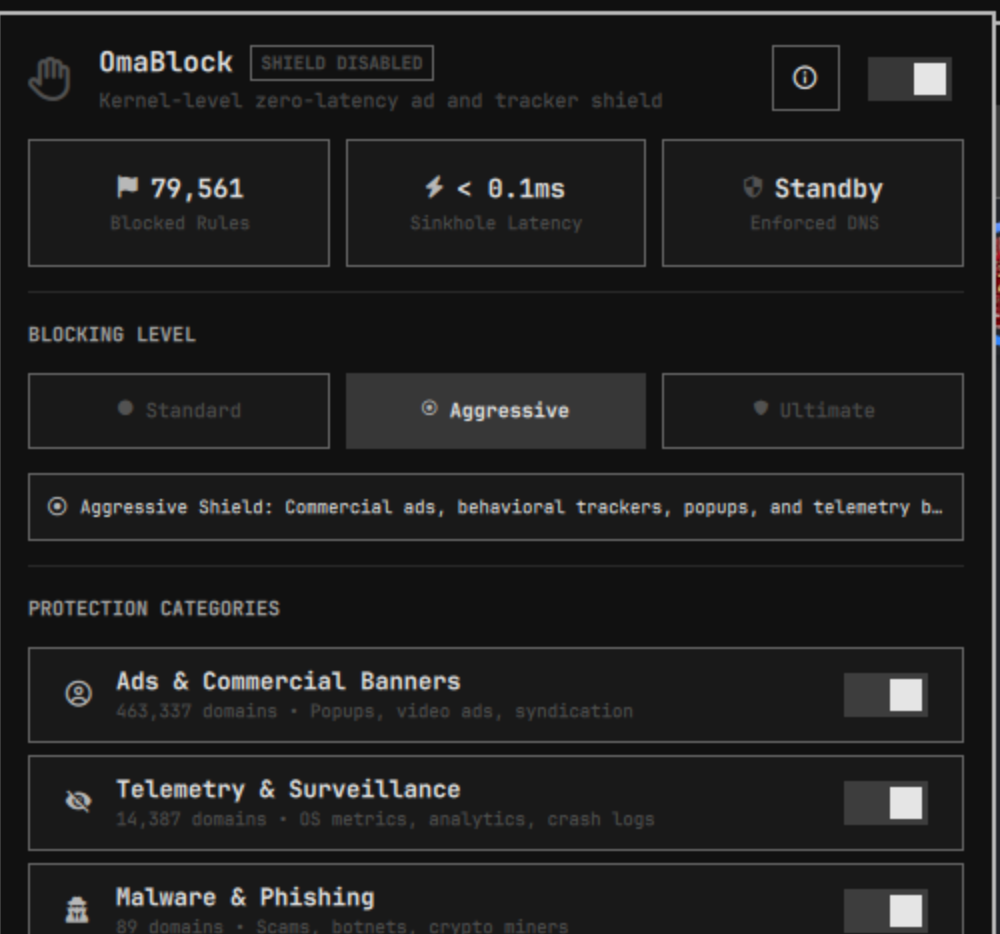

# OmaBlock - Zero-Latency AdBlocker and Privacy Shield for Omarchy Linux

[](https://github.com/ozdil)
[](https://buymeacoffee.com/ozdil)



System-wide ad, tracker, and telemetry sinkhole plugin engineered for Omarchy Linux.

Author: Ozan Ozdil (ozdil)  
License: MIT  
Plugin ID: ozdil.omablock

---

## What's New in 1.5.0

- Correct kernel rules: the nftables tables are written correctly and applied through the privileged helper.
- Safer `/etc/hosts` sync: atomic writes that keep the file's mode and owner, and every rule validated as a domain first.
- Pause ends on its own, and `omablock --restore-hosts` puts back the original `/etc/hosts`.
- Accurate status: the panel shows the real number of active rules and a clear message for each exit code.
- Chrome / Chromium extension in English and Turkish, with a per-tab badge and no ad flash on load.
- End-to-end, Rust and QML tests run in CI on every change.

Full list: [CHANGELOG.md](CHANGELOG.md)

---

## Features

- Zero Latency (< 0.1ms): Blocked domains are written to `/etc/hosts` as `0.0.0.0` sinkhole entries, which the system resolver (glibc NSS, in user space) answers locally without a middleman proxy or battery drain.
- Military-Grade HANCORE Defense: Deep integration of self-defense features including Self-Integrity Verification (SHA-256 binary hashing) and `prctl(PR_SET_DUMPABLE, 0)` anti-tamper.
- Kernel Enforcement and Blackout (optional, needs `nftables`): Kernel enforcement adds an `inet omablock` nftables table that rejects DoH (443), DoT (853) and UDP DNS (53) traffic to well-known public resolvers (Cloudflare, Google, Quad9). Panic Blackout adds an `inet omablock_blackout` table that rejects all non-loopback DNS (53 and 853) until you resume the network.
- AI-Powered Threat Detection: Integrated IDN Homograph and Punycode spoofing radar via advanced DGA Classification engine to stop zero-day phishing typosquatting.
- 79,500+ Curated Rules: Pre-bundled offline database with one-click online synchronization against StevenBlack Unified and EasyPrivacy upstream blocklists.
- Fine-Grained Category Filtering:
  - Commercial Ads: DoubleClick, PageAd, Criteo, Taboola, Outbrain, popups, and video advertising networks.
  - Telemetry and Surveillance: Operating system, analytics, and third-party tracking beacons.
  - Malware and Phishing: Known command-and-control endpoints, cryptominers, and malicious domains.
  - Social Network Trackers: Third-party pixel trackers, audience measurement, and social widgets.
- Live Shield Verification: In-panel live resolution diagnostics to verify protection in real time.
- Custom Allow and Deny Lists: Instantly whitelist or blacklist specific domains with zero DNS downtime.
- Hardware Armor Control (experimental): The USB armor toggle only stores a flag shown in the UI. It does not block USB devices yet.
- Monochrome Design: Native Omarchy UI styling adhering strictly to typography standards and color palette rules.
- OmaBlock Shield Bridge (Chrome / Chromium): Native Manifest V3 extension (English and Turkish UI) that complements the hosts sinkhole with browser-level declarative rules, a per-site allow toggle, and cosmetic filtering for first-party advertising elements.
- Hardened Rust Engine: Strict domain validation, safe atomic file replacement, file locks against concurrent edits, and bounded memory limits.

---

## Architecture

```
+---------------------------------------------------------+
|                   Omarchy Wayland Bar                   |
|                      [ OmaBlock ]                       |
+---------------------------+-----------------------------+
                            | QML IPC / Click
                            v
+---------------------------------------------------------+
|              OmaBlock Control Center (QML)              |
|   - Hero Toggle (ON/OFF)      - Realtime Metrics        |
|   - Category Matrix           - Self-Diagnostic Test    |
|   - Whitelist/Blacklist Chips - Update / Flush          |
+---------------------------+-----------------------------+
                            | CLI / Stdio JSON
                            v
+---------------------------------------------------------+
|              omablock-engine (Rust Native)              |
|   - Pre-bundled ~80k categorized rules                  |
|   - Category filter & Whitelist arithmetic              |
|   - Live latency benchmarking (<0.1ms)                  |
|   - Background updater (curl + deduplication)           |
+---------------------------+-----------------------------+
                            | Polkit helper (/usr/bin)
                            v
+---------------------------------------------------------+
|        omablock-hosts-sync & /etc/hosts Sinkhole        |
|   - Atomic replacement via os.replace                   |
|   - DNS cache purge via resolvectl flush-caches         |
|   - 0.0.0.0 sinkhole for instantaneous connection drop  |
+---------------------------+-----------------------------+
                            | System Sinkhole
                            v
+---------------------------------------------------------+
|         OmaBlock Shield Bridge (Chrome / Chromium)      |
|   - Manifest V3 DeclarativeNetRequest ruleset           |
|   - Cosmetic DOM Injection & first-party ad removal     |
|   - Zero-latency synchronization with system shield     |
+---------------------------------------------------------+
```

---

## Requirements

- cargo and rustc (Rust toolchain, for building from source)
- systemd-resolved (resolvectl, for flushing local DNS cache)

---

## Installation and Setup

### Why Building from Source is Required
Under the Omarchy Linux Security Standards (AGENTS.md Rule 5.3), precompiled binaries are strictly forbidden from Git repositories to guarantee user system integrity. Therefore, the native engine must be compiled from source on your local machine after adding the plugin.

### Step 1: Add the Plugin to Omarchy
```bash
omarchy plugin add https://github.com/ozdil/omarchy-omablock.git
```

### Step 2: Build the Native Engine (User-Space)
Navigate to the plugin directory and run the user-space build script:
```bash
cd ~/.config/omarchy/plugins/ozdil.omablock
./build.sh
```
This builds `omablock-engine` from source and places user executables in `~/.local/bin`.

### Step 3: Install System Sinkhole Helper (Optional)
To enable system-wide `/etc/hosts` and Polkit integration, install the package via Arch package manager. Changes then ask for your password once through Polkit (`auth_admin_keep`), which caches the authorization for a few minutes:
```bash
cd ~/.config/omarchy/plugins/ozdil.omablock
makepkg -si
```

### Step 4: Add to Omarchy Shell Configuration (Optional)
If not automatically added, place `ozdil.omablock` into `bar.layout.right` in `~/.config/omarchy/shell.json`:
```json
{
  "id": "ozdil.omablock"
}
```

### Step 5: Restart Shell
```bash
omarchy-restart-shell
```

---

## Removal & Uninstallation

To cleanly remove OmaBlock:
```bash
cd ~/.config/omarchy/plugins/ozdil.omablock
./uninstall.sh
sudo pacman -R omarchy-omablock 2>/dev/null || true
omarchy plugin remove ozdil.omablock
```

---

## CLI Usage

OmaBlock provides standalone CLI commands:

```bash
# View full status in JSON
omablock --status

# Toggle protection
omablock --toggle
omablock --enable
omablock --disable

# Toggle individual categories
omablock --toggle-category ads
omablock --toggle-category telemetry
omablock --toggle-category malware
omablock --toggle-category social

# Manage Whitelist
omablock --whitelist-add adservice.google.com
omablock --whitelist-remove adservice.google.com

# Manage Blacklist
omablock --blacklist-add annoying-site.com
omablock --blacklist-remove annoying-site.com

# Run real-time resolution test
omablock --test

# Sync latest rules from cloud blocklists
omablock --update

# Flush system DNS resolver cache
omablock --flush

# Blocking level and pause
omablock --set-level standard|aggressive|ultimate
omablock --pause 15        # resumes on its own through a systemd user timer
omablock --resume

# Emergency network blackout (needs nftables)
omablock --panic-blackout
omablock --resume-network

# Restore /etc/hosts from /etc/hosts.omablock.bak (taken before OmaBlock's first change);
# the current file is kept as /etc/hosts.omablock.pre-restore
omablock --restore-hosts

# Compare the running binary with the hash recorded at install time
# exit 0 = OK, 1 = MISMATCH, 3 = UNKNOWN (no install record)
omablock verify-integrity
```

Exit codes: `0` success, `1` the change was saved but applying it to the system failed, `2` invalid domain, category or option, `4` the change was saved but the system helper (`omablock-hosts-sync`) is not installed.

---

## Security and Architecture Standards

OmaBlock complies strictly with the Omarchy Linux Security Standards (AGENTS.md):
- Safe File Synchronization: Hosts file modifications are performed atomically via staging files, ensuring no partial writes or DNS downtime.
- Subprocess Isolation: Process executions run in isolated process groups (`cmd.process_group(0)`) with monotonic deadlines and 16 to 32 KiB output caps.
- Input Sanitization: Domain inputs are strictly validated against domain name standards to prevent configuration poisoning.
- Plain Text UI: All dynamic text rendered in QML components utilizes `textFormat: Text.PlainText` to prevent script and markup injection.

---

## Support & Sponsorship

If you find OmaBlock useful and want to support independent Linux security tools:

<a href="https://buymeacoffee.com/ozdil" target="_blank"></a>

---

## License

MIT License. See [LICENSE](LICENSE) for details.
